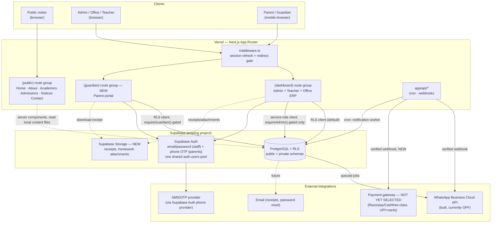

# Uttam Niketan — ERP Software Architecture

**Date:** 2026-11-17
**Status:** Design document — documentation only, no code/schema/config changed. Pending human approval before implementation.
**Builds on:** [`ERP_TECHNICAL_AUDIT.md`](./ERP_TECHNICAL_AUDIT.md) (2026-11-17), treated as source of truth per Step 1.

---

## 0. Process note on the audit dependency

`docs/ERP_TECHNICAL_AUDIT.md` exists and is complete, but **only on the unmerged branch `audit/erp-technical-audit`** — it is not yet on `main`. This document is branched from that branch so the reference resolves, but flagging it: merge the audit PR before (or together with) this one, or `docs/ERP_TECHNICAL_AUDIT.md` won't exist on `main` when this document lands there.

One factual update since the audit was written: the audit's §0 and §3 state the hosted Supabase database had env vars wired up but **no migrations applied**, blocking staff login. That has since been resolved in this session — all 5 existing migrations are applied to the live database, the school/academic-year/11-classes setup ran, and the owner's account is linked as `admin`. Staff login is now functional (pending the owner disabling public sign-up in the Supabase dashboard, which only they can do). Everything else in the audit — schema, RLS design, code quality findings — was re-verified directly against the migration SQL while writing this document and is accurate.

---

## 1. Executive summary

The existing codebase is not a blank slate. It already implements, correctly and with RLS enforcement, the **Admin** and **Teacher** sides of a school ERP: students, classes/sections, academic years, a transactional attendance engine, staff management, and a complete (currently off) WhatsApp absence-notification pipeline. Code quality is materially above average for a project this size — consistent server-side authorization, a proven security-definer-function pattern for every multi-step write, and an audit-log table already wired into attendance.

This document's job is to extend that foundation with three genuinely new pieces the existing system has no model for at all:

1. **A Parent/Guardian identity and access layer** (mobile OTP login, multiple linked children) — net-new, not an extension of `profiles`.
2. **Fee management** (cash + online payments, partial payments, receipts, reversals) — net-new schema and workflow.
3. **A third staff role, "office staff"**, distinct from full `admin`, so attendance can be marked by non-teaching office staff without granting them financial or settings access — a small but real extension to the existing `app_role` enum.

Homework is also new but small (one table, admin/teacher write, everyone-in-scope read) and is designed to reuse the same patterns.

The guiding principle throughout: **reuse the existing, proven patterns** (RLS + security-definer functions for every write that must be atomic and audited; Zod validation mirroring `lib/validation/student.ts`; the `notification_jobs` claim/complete/dedupe pattern for anything queued) rather than inventing new ones. Nothing about the public website, the existing Next.js version, or the existing Supabase project needs to be replaced.

---

## 2. Existing project assessment

Confirmed directly from the repository (`bugs101196/uttam_niketan`, branch `main`) while writing this document — not assumed:

| Area | Confirmed state |
|---|---|
| Framework | Next.js 15.5.28, App Router, TypeScript 5 strict, Tailwind 4 |
| Routing | Route groups: `(public)`, `(auth)/login`, `(dashboard)`, plus `app/api/*` route handlers |
| Middleware | `src/middleware.ts` — single `matcher` array of protected prefixes (`/dashboard`, `/students`, `/attendance`, `/reports`, `/staff`, `/settings`), refreshes the Supabase session cookie, redirects signed-out visitors to `/login`. Explicitly documented as "convenience only" — every page/action re-checks. |
| Auth (staff) | Supabase Auth, email/password, no public self-registration. `lib/auth/staff.ts` exposes `getStaff()` / `requireStaff()` / `requireAdmin()`, backed by a `profiles` table (`role: admin \| teacher`). |
| Database | 10 core tables + `notification_jobs`, all with RLS enabled, 21 policies, two schemas (`public`, `private` for security-definer helpers not exposed via the Data API). |
| Attendance | Entirely written through 5 security-definer functions (`open_attendance_session`, `save_attendance_draft`, `submit_attendance_session`, `correct_attendance_record`, `lock_attendance_session`). Clients have **read-only** table grants on `attendance_sessions`/`attendance_records`. |
| `can_take_attendance(section_id)` | **Already true for admin (school-wide) OR an assigned teacher** — i.e., the existing function already covers "admin can mark attendance." What it does *not* have is a role narrower than full admin that can take attendance but not touch fees/settings/staff — that's the "office staff" gap this document closes. |
| Notifications | `notification_jobs` table + `claim_notification_jobs`/`complete_notification_job`/`apply_whatsapp_status`, service-role-only, dedupe key, exponential backoff, webhook HMAC verification already implemented for WhatsApp. This exact pattern is the template for payment-gateway webhooks below. |
| Validation | Zod schemas per domain (`lib/validation/student.ts` etc.), FormData parsed via a `parse*Form()` helper, `fieldErrors()` turning a `ZodError` into `{field: message}`. `normalizePhone()` already converts common Indian mobile-number formats to E.164 — directly reusable for parent OTP input. |
| i18n | Static dictionary (`src/i18n/dictionaries.ts`, `en`/`hi`), locale from a cookie read server-side (`src/i18n/server.ts`), no client-side i18n library. |
| Testing | Vitest, 3 projects (`unit`, `db`, `api`); `tests/api/direct-api.test.ts` specifically attacks the Supabase Data API directly, bypassing the app's own server actions — the right template for testing the new RLS policies below. |

**What does not exist at all, confirmed by schema inspection (not assumed):** no `guardians`/`parents` table, no parent-child link table, no fee/payment/invoice tables, no homework table, no `office` role value in `app_role`. The `students` table has `guardian_name`/`guardian_phone`/`preferred_language`/`guardian_notifications_consent` columns — **these exist only to address a WhatsApp absence alert and must not be reused as a parent-portal identity or access-control mechanism** (see §8.3).

---

## 3. System architecture diagram



---

## 4. Application module architecture

### A. Public website (unchanged, no reorganization)

Home, About, Academics, Admissions, Notices, Contact stay exactly where they are (`src/app/(public)/*`), reading from `src/content/*.ts` and `src/lib/school.ts` as today. **No justification exists to restructure these routes** — they are already clean, bilingual, and working. The only public-facing addition is a link to the new parent portal login (e.g., in the site header, alongside the existing "Staff login" link).

### B. Admin ERP (extends `(dashboard)`)

| Module | Status | Notes |
|---|---|---|
| Dashboard | Exists | Extend summary cards with fee-collection and homework counts |
| Students | Exists | No structural change |
| Admissions | **New screen** | Admin-side admissions intake isn't a separate database concept — it's the existing `students` creation flow (`/students/new`) reframed; "Admissions" as its own menu item can simply deep-link there, or host a lightweight enquiry-log table if the school wants pre-admission enquiries tracked (see §17, unresolved) |
| Parents and guardians | **New module** | CRUD for `guardians` + the `guardian_students` link (§8.3) |
| Teachers and staff | Exists (`/staff`) | Extend the role selector to include `office` |
| Classes and sections | Exists (`/settings/classes`) | No structural change |
| Attendance | Exists | `can_take_attendance` already covers admin; extend to `office` (§6.1) |
| Fees and payments | **New module** | §7 |
| Notices | Exists as static content (`src/content/notices.ts`) | Out of scope to convert to DB-backed in this phase unless the school specifically wants in-app notice publishing (flagged in the audit as a "nice to have," not requested in this task's confirmed decisions) |
| Homework | **New module** | §4.D |
| Reports | Exists (`/reports/attendance`) | Extend with a fee-collection report |
| Settings and permissions | Exists (`/settings`) | Extend to manage the new `office` role and, later, payment-gateway configuration |

### C. Teacher ERP (extends `(dashboard)`, role-gated)

Dashboard, Assigned classes, Student list, Attendance, Attendance history all exist today, scoped by `teacher_assignments` + RLS. **New:** Homework (teacher creates for their assigned sections). Teachers get no fee visibility whatsoever (§5).

### D. Parent ERP (new route group `(guardian)`)

Net-new. Mobile OTP login, a dashboard, multi-child switching, attendance (read-only), fee balances, payment history, digital receipts, notices (read of the same public content), homework (read, scoped to the child's section). Entirely new tables and a new identity model — see §6 and §8.

---

## 5. Role-permission matrix

Legend: ✅ full access · 🔸 scoped/own-only · ❌ no access · **RLS** = enforced at the database layer, not just hidden in the UI.

| Capability | Admin | Office staff (new) | Teacher | Parent (new) |
|---|---|---|---|---|
| View/edit school settings | ✅ | ❌ | ❌ | ❌ |
| Create/disable staff accounts | ✅ | ❌ | ❌ | ❌ |
| Manage classes/sections/academic years | ✅ | ❌ | ❌ | ❌ |
| Create/edit students | ✅ | 🔸 (view only, by default — see §17) | ❌ | ❌ |
| View all students, school-wide | ✅ | ✅ | ❌ | ❌ |
| View assigned-section students only | n/a | n/a | ✅ (RLS) | n/a |
| View own children only | ❌ | ❌ | ❌ | ✅ (RLS, via `guardian_students`) |
| Mark attendance | ✅ (own school) | ✅ (own school) | ✅ (assigned sections only, RLS) | ❌ |
| Correct submitted attendance | ✅ | ❌ (confirm — see §17) | ❌ | ❌ |
| Lock attendance sessions | ✅ | ❌ | ❌ | ❌ |
| View attendance history | ✅ (school-wide) | ✅ (school-wide) | 🔸 assigned sections | 🔸 own children |
| **Financial: view fee structures** | ✅ | ❌ | ❌ | ❌ |
| **Financial: record a cash payment** | ✅ | ✅ (own identity recorded as receiver) | ❌ | ❌ |
| **Financial: initiate/verify online payment** | n/a (parent-initiated, server-verified) | n/a | ❌ | ✅ (own children only) |
| **Financial: reverse/correct a payment** | ✅ | ❌ | ❌ | ❌ |
| **Financial: view any payment/invoice data** | ✅ (school-wide) | 🔸 (own-recorded cash receipts only, see §17) | ❌ | 🔸 own children only |
| Create/edit homework | ✅ | ❌ | ✅ (assigned sections only) | ❌ |
| View homework | ✅ | ✅ | 🔸 assigned sections | 🔸 own children |
| View/send notices | ✅ (publish) | ❌ | ❌ (read only) | ❌ (read only) |
| View audit logs | ✅ (school-wide) | ❌ | ❌ | ❌ |
| WhatsApp/notification configuration | ✅ | ❌ | ❌ | ❌ |

**Hard requirements this matrix encodes, each enforced by RLS + a `private.*` helper function, never by hiding a button:**
- Teachers never get a code path that can read `fee_*` tables — no policy grants them `select`, and the service layer never queries fees on their behalf.
- Office staff gets attendance-write parity with admin but zero financial/settings access — a new `private.is_office_or_admin()`-style helper, separate from `private.is_admin()`.
- A parent's RLS access is always mediated by `private.is_guardian_of(student_id)`, mirroring `private.is_assigned_to_section`. There is no "parent can see all students" fallback at any layer.
- Every attendance correction and every fee reversal writes a row to `audit_logs` (already append-only, trigger-enforced) — extending the exact mechanism already in place for `attendance.corrected`.

---

## 6. Routing architecture

No reorganization of existing routes. Additions only:

```
src/app/
├── (public)/                          # UNCHANGED
├── (auth)/login/                      # UNCHANGED — staff login stays separate from parent login
├── (dashboard)/                       # UNCHANGED structure, new leaf routes inside it:
│   ├── fees/                          # NEW — admin only (office sees a cash-collection subset)
│   │   ├── page.tsx                   # student fee search / outstanding balances
│   │   └── [studentId]/page.tsx       # invoice detail, record payment, reversal
│   └── homework/                      # NEW — admin (all) + teacher (own sections)
│       ├── page.tsx
│       └── new/page.tsx
├── (guardian)/                        # NEW route group — parent portal, fully separate identity
│   ├── login/page.tsx                 # phone entry -> OTP entry (two-step, Supabase phone auth)
│   ├── page.tsx                       # dashboard: child switcher + summary
│   ├── attendance/page.tsx
│   ├── fees/page.tsx                  # balance + history + "Pay now"
│   ├── fees/receipt/[paymentId]/page.tsx
│   ├── homework/page.tsx
│   └── notices/page.tsx
└── api/
    ├── cron/notifications/route.ts    # UNCHANGED
    ├── webhooks/whatsapp/route.ts     # UNCHANGED
    └── webhooks/payments/route.ts     # NEW — gateway verification (§7.4)
```

**Why a separate `(guardian)` group and a separate `/parent login`, not reusing `/login`:** staff sign in with email/password against `profiles`; parents sign in with phone/OTP against a completely different identity table (`guardians`, §8.3). Sharing one login form would need branching UI for two different auth flows on day one for no benefit — keeping them separate is simpler, not more complex, and matches the existing precedent of `(auth)/login` already being its own isolated route group.

### Middleware (Next.js 15.5.28, current `middleware.ts`)

The existing middleware does one `supabase.auth.getUser()` call and redirects based on a single `isProtectedPath()` prefix list, matched to `/login`. Extend it — do not replace it — along these lines:

```ts
// lib/auth/paths.ts additions (illustrative, not final code)
export const STAFF_PROTECTED_PREFIXES = [...existing];
export const GUARDIAN_PROTECTED_PREFIXES = ["/parent"]; // excluding /parent/login itself

// middleware.ts: after the existing getUser() call, branch on which
// prefix list matched, and redirect to /login or /parent/login accordingly.
```

Both staff and parents are rows in the **same** `auth.users` table (Supabase Auth is one identity pool regardless of login method) — `auth.uid()` works uniformly in RLS policies either way. The application-level distinction ("is this a staff member or a parent") comes entirely from which identity table (`profiles` vs `guardians`) the `auth.uid()` row appears in. **Invariant to enforce:** a single `auth.users.id` must never appear in both `profiles` and `guardians` — a staff member's work account and a parent's portal account are different humans in this school's context, and nothing in the design should make it easy to blur that line. The `matcher` config array in `middleware.ts` gets `/parent/:path*` added alongside the existing staff prefixes.

A parallel `lib/auth/guardian.ts` mirrors `lib/auth/staff.ts` exactly: `getGuardian()` / `requireGuardian()`, cached per request, same "inactive guardian is signed out" handling.

---

## 7. Supabase integration architecture

### 7.1 Auth: staff vs. parent, side by side

| | Staff | Parent |
|---|---|---|
| Method | Email + password | Phone number + OTP (Supabase Auth phone provider) |
| Identity table | `public.profiles` | `public.guardians` (new) |
| Provisioning | Admin creates via service-role `auth.admin.createUser` (existing `createStaffAccount` pattern) | Parent self-registers by verifying their own phone via OTP; **but portal access to a specific child is never self-service** — see §8.3 |
| Session client | `lib/supabase/server.ts` (RLS, cookie-based) | Same client, same cookie mechanism — no new client code needed |
| Disabling access | `profiles.is_active = false` | `guardians.is_active = false` |

Supabase's phone-auth OTP flow needs an SMS provider configured in the Supabase dashboard (Twilio, MessageBird, or a similar supported provider — **not yet selected**, see §10). This is a dashboard configuration step for the project owner, not application code.

### 7.2 Parent-child relationships

```sql
-- Illustrative DDL, for review — not applied in this document.
create table public.guardians (
  id uuid primary key references auth.users (id) on delete restrict,
  school_id uuid not null references public.schools (id),
  full_name text not null check (btrim(full_name) <> ''),
  phone text not null check (phone ~ '^\+[1-9][0-9]{7,14}$'),
  preferred_language public.app_language not null default 'hi',
  is_active boolean not null default true,
  created_at timestamptz not null default now(),
  updated_at timestamptz not null default now(),
  unique (school_id, phone)
);

create table public.guardian_students (
  guardian_id uuid not null references public.guardians (id),
  student_id uuid not null references public.students (id),
  relationship text, -- "Father", "Mother", "Guardian" — free text, school's own wording
  created_at timestamptz not null default now(),
  primary key (guardian_id, student_id)
);
```

**Deliberately not auto-derived from `students.guardian_phone`.** That column exists solely to address WhatsApp absence alerts and was never designed as an access-control signal — a phone number can be reassigned, mistyped, or shared. Linking a guardian account to a specific child is an **explicit admin (or office staff) action** in the new "Parents and guardians" admin module, the same way teacher-to-section assignment is an explicit admin action today, not an inference. A parent can register (verify their own phone) before any child is linked to them; until linked, their dashboard shows zero children and no data.

### 7.3 Teacher-class assignments

Unchanged — `teacher_assignments` already does this correctly (§2).

### 7.4 Server-side authorization pattern (apply uniformly to every new feature)

Exactly the existing three-layer model, repeated for parents and fees:

1. **RLS policy** on every new table, keyed off a `private.*` helper (`private.is_guardian_of(student_id)`, `private.is_office_or_admin()`), mirroring `private.is_assigned_to_section`/`private.is_admin()` exactly.
2. **Security-definer function** for any write that must be atomic and audited (recording a payment, reversing a payment, marking attendance as office staff) — modeled directly on `submit_attendance_session`/`correct_attendance_record`.
3. **Server-side check at the top of every page and action** (`requireGuardian()`, extended `requireStaff()`/`requireAdmin()` for the `office` role) — never a client-side-only guard.

**Never assume an authenticated user may access every record.** Every new RLS policy scopes by `school_id` and, for parents, additionally by `guardian_students` membership — the same two-level scoping (school, then specific assignment) already used for teachers and sections.

### 7.5 Storage (new — receipts and homework attachments)

The project currently uses no Supabase Storage bucket (gallery photos are static build assets). Receipts and optional homework attachments are the first real use case:

- `receipts` bucket: private, generated server-side as PDF (or simple styled HTML-to-PDF) after a payment is recorded/verified, named by payment ID. Access via a short-lived signed URL requested through a server action that first checks `private.is_guardian_of(student_id)` or `private.is_admin()` — never a public bucket.
- `homework-attachments` bucket: private, teacher-uploaded, served the same way, scoped by section assignment / guardian-child link.

### 7.6 Error handling

Follow the existing SQLSTATE convention already documented in the migrations (`42501` forbidden, `P0002` not found, `22023` invalid input, `55000` wrong state) for every new function, and the existing `lib/db-errors.ts` mapping into the error helpers teacher/admin action handlers already use. Payment-gateway errors get their own narrow mapping (declined, network timeout, signature invalid) surfaced as a safe, generic parent-facing message — never the raw gateway error.

**Never expose the service-role key in browser code.** This is already correctly isolated in `lib/supabase/admin.ts` (server-only, `requireAdmin()`-gated). Every new service-role use (creating a parent's linked-child audit entry server-side, generating a signed receipt URL) must go through that same single file, never a new ad hoc client.

---

## 8. Authentication architecture

### 8.1 Staff (unchanged)

Covered in §2 and §7.1 — no changes needed beyond extending `app_role`.

### 8.2 The `office` role

```sql
alter type public.app_role add value 'office'; -- additive, non-breaking
```

Then:
- `private.can_take_attendance(section_id)` gains an `or private.is_office_or_admin()`-style branch (new helper: `office` or `admin` role, same school) alongside the existing admin/assigned-teacher check.
- No other existing policy changes: office staff gets exactly attendance-write parity with admin and nothing else, by simply never being granted additional policies.
- `/staff` admin screen's role selector gains "Office staff" as a third option.

### 8.3 Parent OTP authentication flow

1. Parent visits `/parent/login`, enters phone number (reuse `normalizePhone()` from `lib/validation/student.ts` for the same India-aware normalization already proven there).
2. Supabase Auth sends an OTP via the configured SMS provider (`supabase.auth.signInWithOtp({ phone })`).
3. Parent enters the OTP; `supabase.auth.verifyOtp(...)` creates/confirms the `auth.users` row and session cookie — standard Supabase phone-auth flow, no custom OTP logic to build.
4. On first successful verification, if no `guardians` row exists yet for this `auth.users.id`, create one (`full_name` collected in a short onboarding step, `phone` from the verified number) — but **no student is linked yet**. The dashboard explicitly shows "No children linked yet — contact the school office" until an admin/office staff member links one via `guardian_students`.
5. `requireGuardian()` (new, mirrors `requireStaff()`) gates every `(guardian)` page and action.

### 8.4 Why not put parents in `profiles`

`profiles.role` is a two-value enum (`admin`, `teacher`, soon `office`) with every existing RLS policy written assuming "a profile row means a staff member of this school." Adding `parent` there would require auditing and rewriting every existing policy to exclude parents explicitly, multiplying the chance of a mistake that leaks staff-only data to a parent account or vice versa. A separate table with its own narrow set of new policies is strictly safer and is also what the original technical audit already recommended.

---

## 9. Fee management workflow

### 9.1 Schema (illustrative, for review)

```sql
create table public.fee_heads (            -- school-level catalog: Tuition, Admission, Exam Fee, etc.
  id uuid primary key default gen_random_uuid(),
  school_id uuid not null references public.schools (id),
  name text not null,
  name_hi text,
  created_at timestamptz not null default now(),
  unique (school_id, name)
);

create table public.fee_structures (        -- amount due per class, per academic year, per fee head
  id uuid primary key default gen_random_uuid(),
  school_id uuid not null,
  academic_year_id uuid not null,
  class_id uuid not null,
  fee_head_id uuid not null references public.fee_heads (id),
  amount numeric(10,2) not null check (amount >= 0),
  foreign key (class_id, school_id, academic_year_id)
    references public.classes (id, school_id, academic_year_id),
  unique (class_id, fee_head_id)
);

create table public.student_invoices (      -- one per student per billing period (e.g. per term)
  id uuid primary key default gen_random_uuid(),
  school_id uuid not null,
  student_id uuid not null references public.students (id),
  academic_year_id uuid not null,
  label text not null,                      -- "Term 1, 2026-27"
  total_amount numeric(10,2) not null check (total_amount >= 0),
  status public.invoice_status not null default 'unpaid', -- unpaid | partial | paid | waived
  created_at timestamptz not null default now(),
  updated_at timestamptz not null default now()
);

create table public.invoice_items (         -- which fee heads make up this invoice
  invoice_id uuid not null references public.student_invoices (id),
  fee_head_id uuid not null references public.fee_heads (id),
  amount numeric(10,2) not null check (amount >= 0),
  primary key (invoice_id, fee_head_id)
);

create table public.fee_payments (          -- append-only ledger; never UPDATE a completed row
  id uuid primary key default gen_random_uuid(),
  school_id uuid not null,
  invoice_id uuid not null references public.student_invoices (id),
  amount numeric(10,2) not null,            -- positive for a payment, negative for a reversal
  method public.payment_method not null,    -- 'cash' | 'online'
  -- cash payments:
  received_by uuid references public.profiles (id),   -- required when method = 'cash'
  -- online payments:
  gateway text,                              -- e.g. 'razorpay' — null for cash
  gateway_order_id text,
  gateway_payment_id text unique,
  gateway_payload jsonb,                     -- raw verified webhook payload, for dispute resolution
  status public.payment_status not null default 'completed', -- completed | reversed
  reversed_payment_id uuid references public.fee_payments (id), -- set on the reversal row, points at the original
  recorded_via uuid references auth.users (id), -- parent (online) or staff (cash) who triggered this row
  created_at timestamptz not null default now(),
  check (method = 'cash' and received_by is not null or method = 'online' and gateway is not null)
);
```

All writes go through security-definer functions (`record_cash_payment`, `verify_and_record_online_payment`, `reverse_payment`) exactly like attendance — clients get `select` only on `fee_payments`/`student_invoices`.

### 9.2 Cash payments

`record_cash_payment(invoice_id, amount, note)` — security-definer, callable by `admin` or `office`. Derives `received_by` from `auth.uid()` (never trusts a client-supplied value, matching the existing "never trust submitted `marked_by`" rule from the audit's own API standards). Inserts the `fee_payments` row and updates `student_invoices.status` (unpaid → partial → paid, based on the running sum) in one transaction. Writes an `audit_logs` entry (`fee.payment.cash`).

### 9.3 Online payments

**Payment gateway not yet selected** (task explicitly says not to assume one) — design is gateway-agnostic:

1. Parent clicks "Pay now" on `/parent/fees`. Server action calls `createOrder()` (thin wrapper, swappable per gateway) to get a `gateway_order_id`.
2. Parent completes payment in the gateway's own checkout UI (redirect or embedded widget, depending on the gateway chosen).
3. **Server-side verification is mandatory before marking anything paid** — the client-reported "success" is never trusted. Two safety nets, both required:
   - The client's post-payment callback triggers `verify_and_record_online_payment(order_id, gateway_payment_id)`, which calls the gateway's **server-to-server** verification API (not just checking a signature client-side) before writing the `fee_payments` row.
   - `app/api/webhooks/payments/route.ts` — a verified webhook (signature check, modeled exactly on the existing `app/api/webhooks/whatsapp/route.ts` HMAC pattern) as the authoritative source of truth, so a payment that succeeds but whose client-side callback never fires (closed tab, network drop) still gets recorded.
4. Idempotency: `gateway_payment_id unique` means a retried webhook or duplicate callback cannot double-record the same payment — the same dedupe principle as `notification_jobs.dedupe_key`.

### 9.4 Partial payments and outstanding balances

`student_invoices.status` is derived (via a view or a small function `invoice_balance(invoice_id)`), never stored as a client-writable field. Balance = `total_amount - sum(completed fee_payments.amount for that invoice)`. Multiple cash/online payments against one invoice are just multiple `fee_payments` rows.

### 9.5 Receipts

Generated server-side immediately after a `fee_payments` row is inserted (cash or verified online), stored in the `receipts` Storage bucket (§7.5), linked by `payment_id`. Parent downloads via a signed URL from `/parent/fees/receipt/[paymentId]`, gated by `private.is_guardian_of`.

### 9.6 Reversals and corrections

**Never UPDATE or DELETE a completed `fee_payments` row** — same "history must never disappear" principle the existing schema already applies to attendance (no cascading deletes anywhere). A reversal is `reverse_payment(payment_id, reason)`: admin-only, security-definer, inserts a new row with `amount` negated, `status = 'reversed'` on the original, `reversed_payment_id` linking them, and an `audit_logs` entry (`fee.payment.reversed`) carrying the reason — mirroring `correct_attendance_record`'s audit pattern exactly.

---

## 10. Attendance workflow (extending the existing engine, not replacing it)

The 5 existing functions (`open_attendance_session` → `save_attendance_draft` → `submit_attendance_session` → `correct_attendance_record` → `lock_attendance_session`) are correct, tested, and stay as-is. The only change: **who may call them.**

| Step | Today | After this change |
|---|---|---|
| Open/save draft/submit | admin or assigned teacher (`can_take_attendance`) | **admin, office, or assigned teacher** |
| Correct a submitted record | admin only | unchanged — admin only, unless the school says otherwise (flagged as an open question, §17) |
| Lock a session | admin only | unchanged |

Duplicate prevention is already solved: `unique (section_id, attendance_date)` on sessions and `unique (session_id, student_id)` on records, plus the idempotent "re-submitting an already-submitted session is a no-op" behavior already in `submit_attendance_session`. Nothing new needed here.

Parent notification triggers already exist for absences via `notification_jobs` + WhatsApp (currently off). No new trigger mechanism needed for parents to *see* attendance in their own dashboard — that's a direct RLS-scoped read (`private.is_guardian_of`) against `attendance_records`, same as a teacher's read today, not a push notification.

---

## 11. Notification architecture

| Event | Mechanism | Status |
|---|---|---|
| Absence alert (WhatsApp) | `notification_jobs` queue, existing | Built, off by default |
| Payment confirmation | New `payment_notification_jobs` table, same claim/complete/dedupe shape as `notification_jobs` — do not generalize into one polymorphic table; the existing codebase's style is explicit typed tables per domain, not a shared catch-all | New, Phase 2 |
| Homework posted | Read-only in parent dashboard initially; a push notification is a Phase 2 nice-to-have, not required by the confirmed decisions in this task | Deferred |
| Parent OTP delivery | Supabase Auth's own phone-provider mechanism, not application code | N/A |

---

## 12. Bilingual and responsive strategy

- **Parent portal is mobile-first by requirement.** Reuse the existing Tailwind breakpoints and the existing `min-h-11`/`min-h-12` tap-target convention already applied throughout the dashboard (`dashboard-nav.tsx`, form buttons) — don't introduce a second design system.
- **Admin/teacher/office must work desktop, tablet, and mobile** — already true today for the existing dashboard; new screens (`/fees`, `/homework`) follow the same `max-w-6xl` container + responsive grid pattern already used in `/students`, `/staff`.
- **Localization:** the existing static-dictionary approach (`src/i18n/dictionaries.ts`) works for the mostly-static public site and staff UI strings, but the parent portal's content is data-driven (a child's name, a fee amount, a homework description in whichever language the school entered it). Recommendation: keep UI chrome (buttons, labels, nav) in the static dictionary exactly as today; store **data fields that need both languages** (fee head names, homework text) as `{ en: text, hi: text }` pairs in the database, the same pattern `notices.ts`/`gallery.ts` already use for static content, just DB-backed instead of code-backed.
- **Language switching:** parents get the same cookie-based switch already built for the public site (`src/app/actions/locale.ts`), defaulting to `hi` for a parent (matching `students.preferred_language` default) rather than `en`.
- **Date formatting:** reuse `formatNoticeDate()`'s `Intl.DateTimeFormat` pattern (already locale-aware, already handles `hi-IN` vs `en-IN`) for invoice dates, payment dates, and homework due dates — don't write a second date formatter.
- **Typography:** no change — existing Tailwind type scale covers both scripts adequately; Devanagari rendering already works today on the public site (verified in the audit and again in this session's own browser check).

---

## 13. Security architecture

Everything in the existing audit's security assessment (§6 of `ERP_TECHNICAL_AUDIT.md`) still applies and is the baseline every new piece must meet or exceed:

1. **RLS on every new table, no exceptions** — `guardians`, `guardian_students`, `fee_heads`, `fee_structures`, `student_invoices`, `invoice_items`, `fee_payments`, `homework`, any new notification table.
2. **No client writes to financial tables** — `fee_payments`/`student_invoices` get `select`-only grants to `authenticated`; every write is a security-definer function, same as attendance.
3. **Server-side gateway verification is mandatory** — a client claiming "payment succeeded" is never sufficient (§9.3).
4. **Audit trail for every financial write and every attendance correction** — reuse `audit_logs`, already append-only and trigger-protected.
5. **Never expose `SUPABASE_SERVICE_ROLE_KEY`** — all admin-client use stays in `lib/supabase/admin.ts`, `requireAdmin()`-gated, server-only (`import "server-only"` already enforced throughout the codebase).
6. **A parent's access is always mediated through an explicit admin-managed link** (`guardian_students`), never inferred from a phone number match against `students.guardian_phone` — closes a real risk (a wrong or stale phone number silently granting portal access to the wrong person).
7. **Direct-Data-API attack tests, same as today** — `tests/api/direct-api.test.ts` gets new cases: a teacher querying `fee_payments` directly (must return nothing), a parent querying another family's `guardian_students` row (must return nothing), a parent calling `record_cash_payment` (must be rejected — not an admin/office function).
8. **Carry over the audit's one open item:** teachers can currently read guardian-phone columns via the raw Data API even though the UI hides them (self-flagged, low severity). Fix it now while building `guardian_students`-adjacent policies, rather than letting it linger — narrow the `students` select policy or move guardian contact fields to a view, scoped so a teacher's `select` grant excludes `guardian_phone`/`guardian_name`.

---

## 14. Folder structure proposal

Extends, does not restructure, the existing layout (full current tree in the audit §2):

```
src/
├── app/
│   ├── (public)/                 # unchanged
│   ├── (auth)/login/              # unchanged
│   ├── (dashboard)/
│   │   ├── fees/                  # NEW
│   │   └── homework/              # NEW
│   ├── (guardian)/                # NEW top-level group
│   └── api/webhooks/payments/     # NEW
├── components/
│   ├── fees/                      # NEW — invoice table, payment form, receipt view
│   ├── homework/                  # NEW
│   └── guardian/                  # NEW — child switcher, OTP input
├── lib/
│   ├── auth/
│   │   ├── staff.ts                # unchanged
│   │   ├── guardian.ts             # NEW — mirrors staff.ts
│   │   └── paths.ts                # extended with guardian prefixes
│   ├── payments/                   # NEW — gateway-agnostic client wrapper, webhook verification
│   └── validation/
│       ├── guardian.ts             # NEW
│       └── payment.ts              # NEW
├── services/
│   ├── fees.ts                     # NEW
│   ├── homework.ts                 # NEW
│   └── guardians.ts                # NEW
└── types/database.ts                # regenerated (npm run gen:types) after each new migration
supabase/migrations/
├── 20261118000100_office_role.sql           # NEW
├── 20261118000200_guardians.sql              # NEW
├── 20261118000300_fees.sql                   # NEW
└── 20261118000400_homework.sql               # NEW
```

No existing file moves. No existing route changes path. This is purely additive.

---

## 15. Development standards

- **TypeScript:** `strict` mode stays on (already is); every new table gets its types from `npm run gen:types`, never a hand-written duplicate of the generated `Database` type.
- **Validation:** every new form/action gets a Zod schema in `lib/validation/*`, following `student.ts`'s exact shape — a schema, a `parse*Form()` FormData reader, reuse of `fieldErrors()`.
- **Service layer:** one file per domain in `src/services/*`, functions take a `Staff`/`Guardian` and plain params, return plain data — no business logic in page components, matching `services/students.ts`.
- **Forms/error/loading/empty states:** reuse the existing conventions already established (`StudentFormState`-style discriminated state, `fieldErrors`, the existing `error.tsx`/`loading.tsx`/`not-found.tsx` per route group) — a new `(guardian)/error.tsx` and `(guardian)/loading.tsx` following the same shape as `(dashboard)`'s.
- **Logging:** server-side `console.error` with the existing restraint already shown in `createStaffAccount`/the WhatsApp webhook (log an error code, never a stack trace or secret, never guardian/financial PII) extended to payment verification failures.
- **Environment configuration:** new `.env.example` entries only for what's genuinely new — payment gateway keys (server-only, never `NEXT_PUBLIC_`), SMS/OTP provider keys (configured in Supabase dashboard, not app env, per Supabase's own phone-auth setup). No new variables for anything already covered by `NEXT_PUBLIC_SUPABASE_*`/`SUPABASE_SERVICE_ROLE_KEY`.
- **No unnecessary libraries.** Supabase's own phone-auth covers OTP — no separate OTP library. No payment-gateway SDK is added until a gateway is chosen (§17); the design in §9.3 is written to work with a thin, swappable wrapper rather than a vendor SDK baked into the schema.

---

## 16. Testing strategy

Extend the existing 3-project Vitest setup (`unit`, `db`, `api`) — do not introduce a second test runner:

- **`unit`:** new Zod schemas (guardian phone validation reusing `normalizePhone`), fee-balance calculation (`invoice_balance`), payment-amount/reversal arithmetic.
- **`db`:** new RLS policy tests following `tests/db/rls.test.ts`'s existing shape — a parent can read only their linked children's attendance/invoices; a teacher gets zero rows from `fee_payments`; `record_cash_payment` rejects a teacher caller; `reverse_payment` rejects anyone but admin.
- **`api`:** extend `tests/api/direct-api.test.ts` with the attack cases listed in §13.7.
- **Manual/browser:** full parent OTP flow against a local Supabase stack with a test SMS provider (Supabase supports a test/bypass OTP mode for local dev); full cash-payment flow as office staff; full online-payment flow against the chosen gateway's sandbox once selected.

---

## 17. Risks and unresolved decisions

**Must be answered before implementing the fee module (blocking):**
1. **Which payment gateway?** Design in §9.3 is gateway-agnostic, but a real implementation needs one chosen (Razorpay and Cashfree are the common India-market, UPI-capable choices; neither is assumed or selected here).
2. **Can office staff correct a submitted attendance record, or admin only?** The matrix in §5 defaults to "admin only" (current behavior), but the task's confirmed decisions don't explicitly resolve this for the *correction* step, only the *marking* step.
3. **Can office staff view fee/payment data (read-only), or is that admin-exclusively visible?** §5 defaults to "own-recorded cash receipts only" as the narrowest reasonable default; needs school confirmation.
4. **Fee structure granularity:** per-class-per-year is assumed (§9.1); confirm whether the school needs per-student discounts/scholarships from day one or whether that's a later change request.
5. **Billing period:** "per term" is assumed in `student_invoices.label`; confirm the school's actual billing cadence (monthly? per-term? annual?).

**Should be answered before implementation, non-blocking (sensible defaults chosen, confirm or override):**
6. Does "Admissions" need a dedicated pre-enrollment enquiry table, or is linking to the existing student-creation flow sufficient (§4.B)?
7. Should notices move from code-defined (`notices.ts`) to database-backed/admin-publishable now that an admin notices-management screen is in scope, or stay as-is?
8. SMS/OTP provider selection for Supabase's phone-auth integration (Twilio, MSG91, etc. — this user has used MSG91 on another project, worth considering for consistency, but not decided here).
9. Homework push notifications: deferred to Phase 2 per §11 — confirm that's acceptable for launch.

**Risks:**
- **Scope size:** this is substantially larger than the original 4-week MVP roadmap's explicit exclusions (fees, parent portal, homework were all explicitly out of scope in `docs/PROJECT_ROADMAP.md` §4.4). Treat this as a formal change request against that roadmap, not a quiet scope expansion — the roadmap's own §24 change-request process applies.
- **Payment security is the highest-stakes new surface area in this codebase.** Get the gateway's server-to-server verification exactly right before any real money moves through it; test the webhook idempotency and signature verification as thoroughly as the WhatsApp webhook already was.
- **Parent-child linking is a real-world process problem, not just a technical one** — the school needs an operational procedure for verifying that the person claiming to be "Student X's mother" actually is, before an admin links the account. That's a school-process decision, not something code can fully solve.

---

## 18. Implementation sequence

Priority order, each phase independently shippable and testable before the next starts — following the existing roadmap's own "small, reliable, secure release each week" principle:

1. **`office` role** (§8.2) — smallest change, immediately useful, no new tables, low risk. Unblocks office staff taking attendance without waiting on anything else.
2. **`guardians` + `guardian_students` schema, RLS, and the admin "Parents and guardians" management screen** — no parent-facing UI yet, just the data model and admin tooling to link children. Test RLS thoroughly here before building anything parent-facing on top of it.
3. **Parent OTP login + read-only dashboard** (attendance, notices) — no money involved yet, lowest-risk way to validate the whole parent identity model end-to-end with real users before fees are anywhere near it.
4. **Homework module** (admin/teacher write, parent/student-side read) — small, no financial risk, exercises the same RLS-scoping pattern again.
5. **Fee schema + cash payments only** (office/admin recording cash, parent read-only balance view) — get the ledger, invoice, and audit model right and tested before any gateway integration touches it.
6. **Online payment gateway integration** (once selected) — webhook, server-side verification, receipts. Last, because it's the highest-risk piece and should build on an already-proven invoice/ledger model from step 5.
7. **Reports extensions** (fee-collection report, homework completion visibility) — once the underlying data exists.

Each phase gets its own migration file(s), its own RLS tests before any UI, and its own entry in `docs/PROJECT_ROADMAP.md`'s decision log and status tracker, per the existing working method already established for this project.
